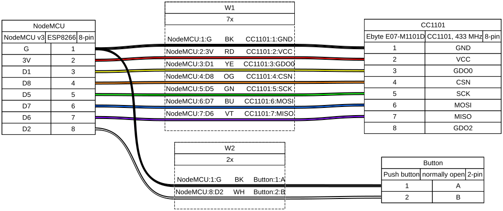

# esp8266-gate-opener

A push button that opens a 433 MHz gate barrier. An ESP8266 drives a CC1101 radio module and
replays the code of the barrier's original fixed-code remote for as long as the button is held.
Optionally it is also a HomeKit switch, so the gate opens from the Home app, Siri and a HomePod.

A personal project, shared as a reference for anyone building something similar.

## How it works

The original remote is read once with the `sniffer` firmware; its code, protocol and pulse
length go into `include/secrets.h`. The main firmware then generates the same OOK signal with
[rc-switch](https://github.com/sui77/rc-switch) on the CC1101's GDO0 pin, and the CC1101, in
asynchronous serial mode, transmits it at 433.92 MHz and about 10 dBm. Transmission repeats while
the button is held, for at least 0.5 s and at most 10 s.

With WiFi configured, the board also runs a HomeKit accessory server
([Arduino-HomeKit-ESP8266](https://github.com/Mixiaoxiao/Arduino-HomeKit-ESP8266)): turning the
switch on transmits for 1 s, then the switch turns itself off. The button works with or without
WiFi. Without WiFi configured, WiFi stays off.

## Hardware

| Qty | Part | Notes |
|---|---|---|
| 1 | NodeMCU v3 (ESP8266, ESP-12, CH340 USB) | A Wemos D1 mini should work too |
| 1 | Ebyte E07-M1101D v2.0 (CC1101, 433 MHz) | SMA connector, 3.3 V only |
| 1 | 433 MHz antenna, SMA | Fit it before transmitting |
| 1 | Push button, normally open | |
| — | Jumper wires, USB 5 V supply | |

## Wiring



| E07-M1101D pin | Signal | GPIO | NodeMCU v3 |
|---|---|---|---|
| 1 | GND | GND | G |
| 2 | VCC | 3V3 | 3V |
| 3 | GDO0 | GPIO5 | D1 |
| 4 | CSN | GPIO15 | D8 |
| 5 | SCK | GPIO14 | D5 |
| 6 | MOSI | GPIO13 | D7 |
| 7 | MISO | GPIO12 | D6 |
| 8 | GDO2 | — | not connected |
| — | Button | GPIO4 | D2, other leg to G |

- Power the CC1101 from **3V**, never from VU/VIN, which carry 5 V.
- Pin 1 is bottom left, seen from the component side. Check it with a multimeter before powering
  up: it is connected to the SMA connector's body.
- Using another board: change `board` in `platformio.ini` and map the same GPIOs.

## Getting started

The project builds with [PlatformIO](https://platformio.org): install the
[PlatformIO IDE](https://platformio.org/install/ide?install=vscode) for VS Code, or just the
[Core CLI](https://docs.platformio.org/en/latest/core/installation/index.html) with
`pipx install platformio`. `platformio.ini` pins the board, core and library versions.
[mise](https://mise.jdx.dev) users can run `mise install` instead: `mise.toml` pins the CLI.

1. **Read your remote.** Flash the sniffer, open the serial monitor and press the remote:

   ```sh
   pio run -e sniffer -t upload -t monitor
   ```

   ```
   code=101010101010  bits=12  protocol=11  pulse=320 us  RSSI=-30 dBm
   ```

2. **Configure.** Copy the template and fill in code, protocol and pulse length:

   ```sh
   cp include/secrets.example.h include/secrets.h
   ```

   `secrets.h` is gitignored. For HomeKit, also set `WIFI_SSID`, `WIFI_PASSWORD` (a 2.4 GHz
   network) and `HOMEKIT_SETUP_CODE`, a pairing code of your choice in the `XXX-XX-XXX` format;
   leave `WIFI_SSID` empty for a button-only opener.

3. **Flash the opener:**

   ```sh
   pio run -t upload -t monitor
   ```

   The boot log ends with `Ready, HomeKit on` (or `off`). Pressing the button prints
   `Transmitting`, releasing it `Released`; holding it past 10 s prints `Timeout`.

## HomeKit

1. **Pair.** On an iPhone on the same network: Home app, **+**, *Add Accessory*, *More
   options…*, pick *Gate Opener*, accept the uncertified accessory warning and enter your
   `HOMEKIT_SETUP_CODE`. The first pairing takes up to a minute on the ESP8266.
2. **Use.** Tap the switch, or ask Siri on an iPhone, Apple Watch or HomePod to turn it on: with
   the accessory named *gate*, "Hey Siri, turn on the gate". Siri's "open" only applies to doors,
   locks and blinds, so "open the gate" does not find a switch. With a home hub (HomePod or Apple
   TV) it works away from home too, with no ports opened on the router.
3. **Pair again.** After removing the accessory from the Home app, erase the board's flash, where
   the pairing is stored, and flash again: `pio run -t erase`, then `pio run -t upload`.

The gate is a switch and not a garage door on purpose. A garage door shows an open or closed
state, which this barrier cannot report. It is also a secure accessory, so Siri on a HomePod asks
for confirmation on an iPhone before opening it. A switch opens without confirmation: anyone who
can talk to your HomePod can open the gate, as anyone at home can press the button.

## Firmware

| Environment | Source | Purpose |
|---|---|---|
| `gate_opener` | `src/gate_opener/` | Main firmware: button, and HomeKit if configured (default) |
| `sniffer` | `tools/sniffer/` | Decodes a remote and prints its parameters |
| `rf_tx_test` | `tools/rf_link_test/tx/` | Sends a known test code once a second, at low power |
| `rf_rx_test` | `tools/rf_link_test/rx/` | Prints received codes and peak RSSI every 500 ms |

The radio, button and transmit-timing code lives in `lib/gate_remote/`; `pio test -e native`
runs the unit tests of the transmit timing on the host.

## Troubleshooting

**`CC1101 not found`, or `VERSION` reads `0x00` or `0xFF`.** SPI wiring or power. Check CSN,
SCK, MOSI and MISO, and that VCC is on 3V.

**The barrier does not respond.** Check the radio before the code. With two boards, flash
`rf_tx_test` on one and `rf_rx_test` on the other, 1–2 m apart: the receiver should decode
`0xA5A5xx` with a rising counter. The test transmits continuously, so keep it short. Then flash
`rf_rx_test` on both and press the original remote halfway between them. A healthy module
receives the remote at about -20 to -35 dBm; a module reading -75 dBm or less has a damaged
antenna path (SMA connector, solder joint or module), which also weakens what it transmits.

**`MARCSTATE` is not `0x13` while transmitting or `0x0D` while receiving.** The CC1101 is not in
the expected state; reflash and check the power supply.

## Legal

In Europe, 433.05–434.79 MHz is a band for non-specific short-range devices, limited to 10 mW
e.r.p. with duty-cycle limits (ERC Recommendation 70-03, Annex 1, and
[Commission Decision (EU) 2019/1345](https://eur-lex.europa.eu/eli/dec_impl/2019/1345/oj)).
The firmware transmits about 10 dBm conducted, which stays within that limit with an antenna of
up to 0 dBd (2.15 dBi); with a gain antenna, lower `TX_POWER_DBM`. It transmits only while the
button is held, for at most 10 s, or for 1 s on a HomeKit command. Check the rules where you live.

Only clone a remote you own, for a gate you are allowed to open. A fixed code can be recorded
and replayed by anyone nearby: this device is no more secure than the original remote.

## License

[MIT](LICENSE). Dependencies: [rc-switch](https://github.com/sui77/rc-switch) (LGPL-2.1),
[SmartRC-CC1101-Driver-Lib](https://github.com/LSatan/SmartRC-CC1101-Driver-Lib) (MIT) and
[Arduino-HomeKit-ESP8266](https://github.com/Mixiaoxiao/Arduino-HomeKit-ESP8266) (MIT).
